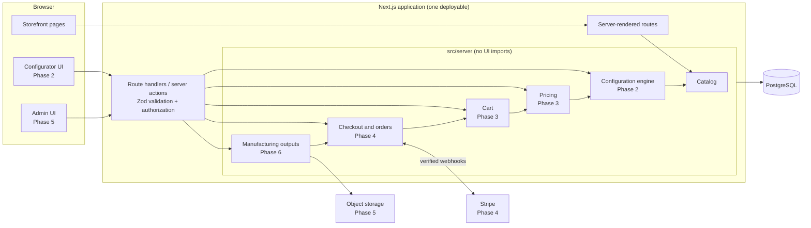

# Architecture

## Repository assessment (Phase 0)

The project folder was empty: no framework, dependencies, tests, scripts or deployment assumptions existed. Everything here was created new, so nothing was replaced.

## Stack

| Concern | Choice | Why | Alternatives considered |
| --- | --- | --- | --- |
| Language | TypeScript, strict | One language across UI, services and scripts | none |
| Web framework | Next.js 16 (App Router), React 19 | Server rendering for SEO pages, server-only code for pricing and validation, one deployable | Remix/React Router: comparable; separate SPA + API: more moving parts than an MVP needs |
| Database | PostgreSQL | Relational integrity, CHECK constraints, JSONB for snapshots, transactions for orders | SQLite: weaker concurrency and types for money/orders |
| Local/test database | PGlite (PostgreSQL compiled to WASM) | Same SQL dialect and migrations as production with nothing to install; real constraint behaviour in tests | Docker Postgres: heavier setup; still supported through `DATABASE_URL` |
| ORM / migrations | Drizzle ORM + drizzle-kit | SQL-first, typed queries, plain SQL migration files that can be reviewed | Prisma: heavier runtime, less direct control over SQL |
| Validation | Zod at every boundary | One schema for parsing URL params, API bodies and stored JSON | none |
| Styling | Tailwind CSS 4 with design tokens in `globals.css` | Tokens in one place, no runtime CSS cost | CSS modules |
| Tests | Vitest (unit, integration), Playwright (end-to-end) | Fast service tests against a real database; browser journeys at three sizes | Jest, Cypress |
| Auth (Phase 4) | Not chosen. Leaning Auth.js with database sessions | Keeps user data in our database, no per-user fee | Clerk: faster to ship, external dependency and cost |
| Payments (Phase 4) | Stripe, test mode only until approved | Named in the spec; hosted card entry keeps card data off our servers | none yet |
| File storage (Phase 5) | S3-compatible object storage, not chosen | Product images, generated exports | local disk in development |

No microservices. One Next.js application with internal service modules.

## System diagram

Solid today: storefront pages, server-rendered routes, catalog service, database. Everything marked with a phase is planned.

## Service boundaries

Each service is a folder under `src/server/<name>` exposing plain async functions that take a database handle. Rules:

- Services never import from `src/components` or `src/app`.
- Components never import the database. Pages call services and pass data down.
- Dependencies point one way: orders → cart → pricing → configuration → catalog.
- The renderer (2D now, 3D later) consumes a configuration; it never feeds validation or price.

| Service | Responsibility | Phase |
| --- | --- | --- |
| Catalog | Published categories, products, designs, materials, finishes; listing filters | 1 (done) |
| Configuration | Validate a configuration against dimension and compatibility rules; persist it | 2 |
| Pricing | Deterministic price with line items, versioned | 3 |
| Cart | Lines that reference validated configurations; revalidation | 3 |
| Checkout / orders | Order state machine, snapshots, payment events | 4 |
| Admin catalog | Authoring, preview, publish, audit | 5 |
| Manufacturing | BOM, cut-list records, labels, packing lists, CSV | 6 |

## Request flow today

1. A route in `src/app` awaits `getDb()` (one connection per server process).
2. URL parameters go through `parseListingParams` (Zod). Malformed values are dropped, never passed to SQL.
3. `src/server/catalog/queries.ts` returns typed view models containing only published, visible content.
4. Server components render HTML. Client JavaScript is limited to the mobile menu, the filter disclosure and the active nav link.

## Rendering and caching

All catalog routes are rendered per request (`dynamic = "force-dynamic"` on the root layout). With a catalog this size a page costs a few milliseconds of queries, and it avoids stale prices while the admin does not exist. The scaffold's Cache Components mode was turned off to keep this simple. Caching with explicit invalidation on publish is a Phase 5/8 task, once there is a publish event to invalidate on.

Because pages are not streamed behind a loading boundary on dynamic segments, unknown products and categories return a real HTTP 404.

## Deployment assumptions

None are fixed yet. The application needs a Node.js 22 runtime and a PostgreSQL database. See [`deployment.md`](deployment.md).
