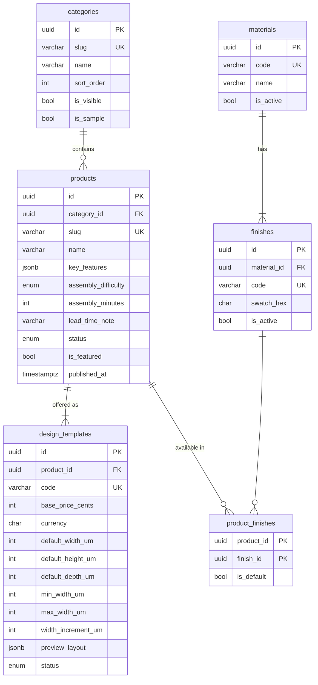
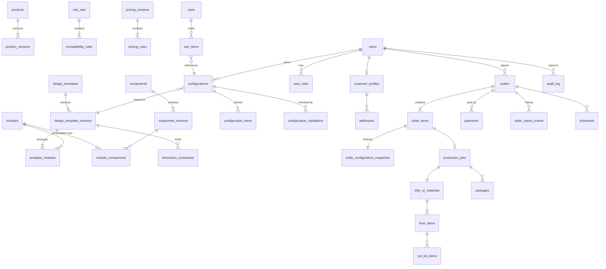

# Data model

## Conventions

- **Money:** integer minor units (`*_cents`) plus an ISO 4217 `currency`. No floating point anywhere.
- **Lengths:** integer micrometres (`*_um`). One inch is exactly 25,400 µm, so every 1/8-inch step and every 0.001 mm is an exact integer. Conversion and display live in `src/lib/units.ts`. Metric display is already supported.
- **Identifiers:** UUID primary keys; human-facing stable codes (`slug`, `code`/SKU) are unique and never reused.
- **Publishing:** `status` is `draft`, `published` or `archived`. The storefront reads only published rows in visible categories.
- **Sample data:** `is_sample` marks seed content. The seed replaces only those rows.
- **Integrity:** foreign keys everywhere; CHECK constraints for prices, ranges and formats; the database rejects invalid rows even if application code is wrong.

## Implemented in Phase 1

Indexes: unique on every slug/code; `products(category_id, status)`; `design_templates(product_id, status)`; `finishes(material_id)`; `product_finishes(finish_id)`.

Two Phase 1 fields are deliberately temporary and will move in Phase 2:

- `design_templates.preview_layout` is an illustrative bay layout. It will be derived from the template's modules.
- Width range and increment on `design_templates` may move to `dimension_constraints` rows. Height and depth stay as fixed columns: they are not configurable (D19).

A CHECK constraint (`design_templates_width_on_step`) requires `max_width - min_width` and `default_width - min_width` to be exact multiples of the increment, so every design's allowed widths are a clean list.

## Planned model

### Three levels, kept separate

| Level | What it is | Example |
| --- | --- | --- |
| Component | A manufactured or purchased part with a SKU, dimensions, cost and manufacturing attributes | Side panel 20″ × 16″, hinge, drawer runner |
| Module | A customer-selectable assembly of components | "Doored cabinet bay, 18″", "Two-drawer bay, 18″" |
| Design template | A valid starting arrangement of modules for a product | "Model B: three cabinets and two drawers" |

Hardware and accessories are components distinguished by `component_type`, not separate tables, unless they later need different attributes.

### Versioning and history

Two mechanisms, used together:

1. **Version rows** for things that are authored and published: product, design template, component, rule set, pricing. Publishing creates a new immutable version; drafts are edited freely. Carts and saved configurations reference a specific version, so a later edit cannot corrupt them. They are revalidated against the current version at add-to-cart and at checkout, and the customer is told when something changed.
2. **Snapshots** for things that must be reproducible forever: an order item stores a complete JSON copy of the configuration, resolved component list, price breakdown, rule and pricing version ids, and policy versions. Reproducing an order never joins to live catalog tables.

### Open modeling questions for Phase 2

- ~~Are module widths a fixed set or a range?~~ Decided (D19): a design's overall width moves in fixed steps; height and depth are fixed per design. Consequence for Phase 2: each module comes in a fixed set of widths, and a width step is realised by swapping or resizing modules to the next size in that set, never by an arbitrary dimension. `dimension_constraints` therefore only needs to describe width.
- Are compatibility rules expressible as a small set of typed rule kinds (`requires`, `excludes`, `fits_within`, `max_total`), or is a general expression language needed? Proposal: start with typed kinds stored as rows with JSON parameters.
